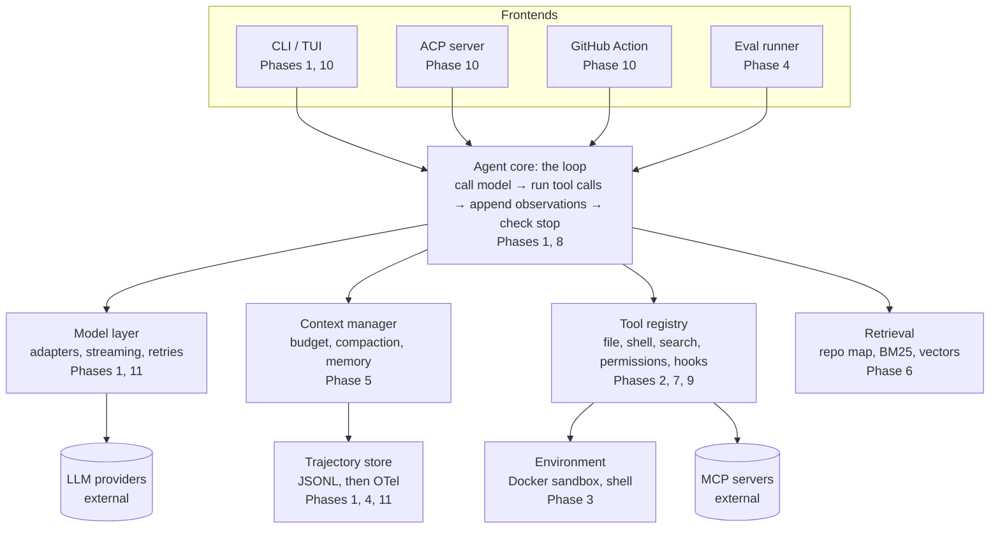

# SWE Agent From Scratch — Build & Learn Roadmap

Snapshot of 2026-10-17. The living version is a Claude doc that is private to the owner; this file is updated in the repo at the end of each phase.

## Goal and how to use this roadmap

Build a model-agnostic, terminal-first coding agent in 12 phases, each shipped as a tagged GitHub release (v0.0.0 → v1.0.0) over roughly 33 weeks at 10–12 hours a week. Every phase teaches one agent concept and ends with a working agent, a benchmark number and a devlog entry.

Guiding principles:

- **One layer at a time.** The agent works end to end after every phase; later phases make it better, never "finally runnable".
- **Measure before you optimize.** The eval harness lands in Phase 4. From then on, every prompt, tool or retrieval change is an A/B test on a fixed task set.
- **From scratch where the learning is.** You write the loop, tools, context manager, retrieval, MCP/ACP protocol code and eval runner yourself. Libraries are fine for plumbing (HTTP, Docker, parsing, storage).
- **Build first, then read the reference.** Write your version of each component, then study how mini-swe-agent, Aider or OpenHands did it, and record the differences in the devlog.
- **Safe by default.** From Phase 3 on, everything the agent executes runs in a sandbox.

Each phase below has four parts: **Learn** (concepts and reading), **Build** (deliverables), **Done when** (a checkable exit test) and a **tag**. Make each phase a GitHub Milestone and each Build bullet an Issue. The project is `swe_agent`: Python package `swe_agent`, CLI command `swe-agent`.

## The mental model

An agent is a model plus a harness ([Agent = Model + Harness](https://blog.langchain.com/the-anatomy-of-an-agent-harness/)), and nearly everything you build in this project is harness. The model is rented through an API; your engineering lives in what surrounds it.

The buzzwords are nested layers, each wider than the last:

1. **Prompt engineering** shapes the wording of one request.
2. **Context engineering** decides which tokens the model sees on each turn: system prompt, tools, history, retrieved code. Anthropic frames it as finding the smallest set of high-signal tokens that gets the outcome ([source](https://www.anthropic.com/engineering/effective-context-engineering-for-ai-agents)).
3. **Harness engineering** is the whole runtime around the model: loop, tools, context management, sandbox, plus *guides* that steer before the agent acts and *sensors* that let it self-correct after ([Böckeler, martinfowler.com](https://martinfowler.com/articles/harness-engineering.html)). The term took off with OpenAI's write-up in [February 2026](https://openai.com/index/harness-engineering/).
4. **Loop engineering** sits one level above the harness: designing the goal, the checks and the stopping point so the system, not a person, keeps work moving across many runs. It is a newer term and not yet standardized.

The other terms are components inside those layers. **RAG** is one retrieval strategy within context engineering. **MCP** is how the harness reaches external tools and data. **ACP** is how the harness talks to code editors. Phases 1–7 together are harness engineering; Phase 7 is where you formalize it.

| Concept | What it means in practice | Phase |
| --- | --- | --- |
| Agent loop / ReAct | Call model → run its tool calls → feed results back → repeat until a stop condition | 1 |
| Tool calling and ACI | Tools shaped for a model's ergonomics: concise output, guardrails, errors that suggest the next step | 2 |
| Sandboxing and permissions | Every command runs isolated; risky actions need approval | 3 |
| Evals | Fixed task sets, resolve rate, cost per task, failure taxonomy | 4 |
| Context engineering | Token budgets, compaction, memory files, prompt caching | 5 |
| RAG and agentic search | grep/BM25 vs embeddings vs repo maps, measured head to head | 6 |
| Harness engineering | Guides (AGENTS.md, skills) and sensors (linters, tests, hooks) | 7 |
| Loop engineering | Goal loops, subagents, best-of-N, long-running work | 8 |
| MCP | Client and server for the Model Context Protocol | 9 |
| ACP and headless mode | Run inside editors; run from CI on GitHub issues | 10 |
| LLMOps | Tracing, fallbacks, security review, release | 11 |

## Architecture and repo layout

The agent core owns the loop; frontends sit above it and pluggable components sit below it, each behind a small interface.



Frontends never touch models or tools directly; they hand a task to the core. That is why adding ACP or a GitHub Action in Phase 10 costs days, not weeks.

```text
swe_agent/
├── src/swe_agent/
│   ├── cli/            # typer CLI, later the TUI (1, 10)
│   ├── core/           # agent loop, budgets, subagents (1, 8)
│   ├── models/         # provider adapters, cost accounting (1)
│   ├── tools/          # registry, built-in tools, permissions (2, 3)
│   ├── env/            # LocalEnv, DockerEnv, shell, checkpoints (3)
│   ├── context/        # budgets, compaction, memory files (5)
│   ├── retrieval/      # repo map, BM25, vector index (6)
│   ├── harness/        # hooks, sensors, skills, verification gate (7)
│   ├── mcp/            # MCP client and server (9)
│   ├── acp/            # ACP server mode (10)
│   └── telemetry/      # trajectories, OpenTelemetry (1, 11)
├── prompts/            # versioned system-prompt templates
├── evals/              # runner, task lists (smoke/dev/pro), results schema
├── tests/              # unit tests + recorded model responses
├── docs/
│   ├── adr/            # architecture decision records
│   ├── devlog/         # one entry per phase
│   └── concepts/       # your own explanation of each concept
├── examples/trajectories/
├── .github/workflows/  # ci.yml, eval.yml, release.yml
├── AGENTS.md
├── pyproject.toml
└── README.md
```

## Tech stack and the "from scratch" rule

Use Python 3.12+. SWE-bench, SWE-bench Pro, mini-swe-agent, the MCP SDK and the ACP SDK all have first-class Python tooling, so your time goes into agent ideas rather than glue.

| Layer | Choice | Why |
| --- | --- | --- |
| Packaging and env | uv, `pyproject.toml` | Fast, reproducible, lockfile in git |
| Quality | ruff (lint + format), pyright, pre-commit | Typed code is easier for you and for agents to change |
| Tests | pytest, pytest-asyncio, your own record/replay layer for model calls | Deterministic CI with zero API cost |
| Data models | pydantic v2 | Tool schemas generated from types |
| Model access | Your own adapters over raw HTTP for two providers + one OpenAI-compatible local endpoint (Ollama or vLLM) | You learn the tool-use wire format; three backends keep the abstraction honest |
| Sandbox | Docker via the Docker SDK (Podman-compatible) | Same isolation SWE-bench uses |
| Code parsing | tree-sitter | Syntax-aware chunking, symbol maps, many languages |
| Retrieval storage | SQLite FTS5 for BM25 + sqlite-vec or LanceDB for vectors | Embedded, no server to run |
| CLI / TUI | typer + rich, then textual | Streaming output, approvals, diffs |
| Telemetry | JSONL trajectories, then OpenTelemetry | Every run is replayable and debuggable |
| Evaluation | SWE-bench harness or sb-cli; Harbor later | Standard scoring |

**Write yourself:** the agent loop, tool registry and tools, context manager and compaction, retrieval pipeline, the first MCP client/server, the first ACP adapter and the eval runner.

**Do not import into the core:** LangChain, LangGraph, LlamaIndex, CrewAI or any agent SDK. Read their code for ideas. Once your hand-rolled MCP client works, you may switch to the official SDK and record the trade-off in an ADR.

**Models:** develop with a cheap, fast model; evaluate with one frontier model pinned to an exact version, so numbers stay comparable across releases.

## Git and GitHub workflow

Run the repo like a product team's repo from day one; the visible process is half of what makes it a portfolio piece.

- **Branching:** trunk-based. `main` is always green. Short-lived branches (`feat/str-replace-tool`, `fix/docker-timeout`), a PR for every change even when solo, squash-merge.
- **Commits:** [Conventional Commits](https://www.conventionalcommits.org/) such as `feat(tools): add str_replace editor` or `perf(context): compact old observations`. They feed an automatic changelog.
- **Releases:** one SemVer tag per phase (Phase 1 → `v0.1.0`, Phase 11 → `v1.0.0`). Each GitHub Release lists what changed, what you learned and the eval numbers. release-please can automate this.
- **Planning:** a Milestone per phase, an Issue per Build bullet, a Projects board (Backlog → In progress → Done). Labels: `phase-N`, `area/tools`, `area/context`, `area/retrieval`, `eval`, `learning`.
- **CI (GitHub Actions):** lint, type-check and unit tests on every PR; replay tests that run the agent against recorded model responses; a manual or nightly workflow for a small live eval, with the API key in Actions secrets.
- **Docs that show learning:**
    - `docs/adr/` — one Architecture Decision Record per real choice (edit format, retrieval strategy, MCP SDK or not).
    - `docs/devlog/phase-NN.md` — what you built, what failed, the numbers, what surprised you.
    - `docs/concepts/` — your own explanation of each concept, written after building it.
    - `AGENTS.md` — instructions for coding agents working on this repo, including your own.
- **Hygiene:** keys only in `.env` (gitignored) plus a secret scanner (gitleaks) in pre-commit. Eval runs and trajectories stay out of git; commit a few curated examples to `examples/trajectories/`.
- **Dogfooding:** from Phase 3 on, have your agent make small PRs to its own repo and label them `made-by-agent`. A growing count of merged agent PRs is a strong signal on your profile.
- **README as storefront:** one-line pitch, architecture diagram, demo GIF, benchmark table updated each release, quickstart.

## Phases 0–3: a working, safe agent

By the end of Phase 3 you have a sandboxed agent that edits real repos with purpose-built tools and logs every step.

### Phase 0 — Foundations · `v0.0.0` · 1 week

**Learn:** modern Python packaging and CI; how two providers' message and tool-use APIs work, bill and rate-limit.

**Build:**

- Repo skeleton: `pyproject.toml`, uv, ruff, pyright, pytest, pre-commit with gitleaks, LICENSE (MIT or Apache-2.0), README stub, `AGENTS.md`, `docs/` folders.
- GitHub Actions CI and branch protection on `main`.
- `swe-agent --version` CLI entry point.
- A throwaway script in `scratch/` that sends one request with one tool definition and prints the tool call, so you see the raw wire format.

**Done when:** a PR runs CI green and `v0.0.0` is tagged.

### Phase 1 — The minimal agent loop · `v0.1.0` · 2 weeks

**Learn:** the ReAct pattern; the tool-use cycle (schema → model emits a tool call → you execute → you return the result); stop conditions; why a bash-only agent goes surprisingly far.

**Build:**

- A `Model` interface with two provider adapters over raw HTTP: messages, tool calls, streaming, token and cost accounting, retry with backoff.
- `Agent.run(task)`: call the model, execute its tool calls, append results, repeat. Stop on a submit action, max steps, max cost or max wall time.
- One tool, `bash`: runs a command in a working directory with a timeout and truncated output.
- A trajectory logger writing every step to JSONL (messages, tool calls, tokens, cost, latency), plus `swe-agent replay <file>`.
- A scripted fake model so the loop has unit tests that never call an API.

**Done when:** `swe-agent run "make the tests pass"` fixes a failing test in a toy repo, the loop core is under about 150 lines, and your devlog compares it with [mini-swe-agent](https://github.com/SWE-agent/mini-swe-agent)'s agent class.

### Phase 2 — Tools and the agent-computer interface · `v0.2.0` · 3 weeks

**Learn:** the Agent-Computer Interface idea from the [SWE-agent paper](https://arxiv.org/abs/2405.15793): tools built for a model, not a human. Edit formats (whole file, search/replace, unified diff) and how each fails.

**Build:**

- A tool registry: each tool declared once (name, pydantic schema, description, permission level, read-only flag) and rendered into each provider's format.
- File tools: `read_file` with line ranges and numbers, `write_file`, `str_replace` (match must be unique; returns the edited region), `glob`, `grep` (ripgrep), `run_tests`.
- Observation shaping: long output becomes head + tail + "N lines omitted"; errors say what to try next.
- Syntax check after each edit; reject edits that break parsing.
- Run parallel tool calls when the model emits several.

**Done when:** on 10 toy tasks the file-tool agent beats the Phase 1 bash-only agent on success rate or steps, and an ADR records your edit-format choice.

### Phase 3 — Sandbox and permissions · `v0.3.0` · 2 weeks

**Learn:** container isolation and resource limits; why prompt injection makes every file, issue and web page untrusted input; allow/ask/deny permission models; persistent shell sessions.

**Build:**

- An `Environment` interface with `LocalEnv` (development only) and `DockerEnv`: repo copied or mounted, network off by default, CPU, memory and time limits, non-root user.
- A persistent shell inside the container so `cd`, environment variables and virtualenvs survive between commands.
- A permission policy: read-only tools auto-allowed, writes inside the workspace allowed, commands checked against allow and deny lists, everything else asks you. Settings live in `.swe_agent/settings.toml`.
- Git checkpoints: the agent works on its own branch or worktree and auto-commits snapshots, so every run is diffable and reversible.
- Secret redaction in logs and trajectories.

**Done when:** Docker is the default environment, tests prove that destructive commands and network calls are blocked or prompted, and `git diff` shows everything a run changed.

## Phases 4–7: measure, then improve

From Phase 4 on, no change ships without an eval number next to it.

### Phase 4 — Evaluation harness · `v0.4.0` · 3 weeks

**Learn:** how SWE-bench scoring works (a Docker image per task; fail-to-pass tests must now pass, pass-to-pass tests must not break); contamination; variance and pass@k; why the same model scores differently under different harnesses.

Benchmark choice matters. SWE-bench Verified (500 Python tasks) is saturated at the frontier, with top reported scores in the mid-90s ([BenchLM, July 2026](https://benchlm.ai/benchmarks/swe-bench-verified)), but it is still a useful development signal with cheaper models. [SWE-bench Pro](https://labs.scale.com/leaderboard/swe_bench_pro) is the credible headline number: 1,865 tasks across 41 repositories in Python, Go, TypeScript and JavaScript, with a 731-task public set. Scale's newest leaderboard entries are run with the mini-swe-agent harness, which makes mini-swe-agent the natural baseline for you.

**Build:**

- An `evals/` runner: load instances from Hugging Face, start the task's image, run your agent, extract `git diff` as the patch, score with the official harness (locally or via sb-cli).
- Three fixed tiers, task lists committed to git:
    - `smoke` — about 10 hand-made tasks, runs in CI with a cheap model.
    - `dev` — a seeded 50-task subset of SWE-bench Verified.
    - `pro` — a seeded subset of the SWE-bench Pro public set.
- A results file per run: resolve rate, cost per task, steps, tokens, wall time, failure category.
- A baseline: mini-swe-agent with the same model on the same `dev` and `pro` subsets.
- A static trajectory viewer and a failure taxonomy (wrong file, bad edit, gave up, looped, timeout, environment error).
- Optional later: an adapter for [Harbor](https://github.com/harbor-framework/harbor), the Terminal-Bench team's framework for evaluating arbitrary agents on many datasets.

**Done when:** `make eval-dev` writes a results file and README table, and you know your gap to the baseline.

### Phase 5 — Context engineering · `v0.5.0` · 3 weeks

**Learn:** the attention budget and why long contexts degrade; just-in-time loading versus preloading; compaction; structured note-taking; prompt caching ([Anthropic](https://www.anthropic.com/engineering/effective-context-engineering-for-ai-agents)).

**Build:**

- A context manager with token accounting per component (system prompt, tools, history, observations) and a budget policy.
- System prompts as versioned templates in `prompts/`, each change A/B tested.
- Project memory: auto-load `AGENTS.md`-style files from the repo root and the directories being edited.
- Observation pruning: shrink old tool outputs to short summaries; drop duplicate file reads.
- Compaction: past a threshold, summarize older turns into a structured "state so far" note and keep the last few turns verbatim.
- A notes tool: the agent keeps a plan and findings in a file that survives compaction.
- Prompt caching with a stable prompt prefix, and a cost report per run.

**Done when:** on long `pro` tasks, tokens and cost per task drop with no loss in resolve rate.

### Phase 6 — Retrieval: agentic search vs RAG · `v0.6.0` · 3 weeks

**Learn:** lexical search (grep, BM25), semantic search (embeddings) and agentic search (the model iterates with grep, glob and read); syntax-aware chunking; hybrid fusion and reranking; repo maps. Claude Code's team reports that early versions used RAG with a local vector database and found agentic search worked better ([talk summary](https://www.ai.engineer/talks/UM6sFg_jdlE-rag-is-dead-right-kuba-rogut)). Build both and let your numbers decide for your agent.

**Build:**

- A repo map: tree-sitter extracts definitions and references, files are ranked over the symbol graph, and a compact map fits a token budget (Aider popularized this).
- A code index: one chunk per function or class, embeddings (API or local), stored in sqlite-vec or LanceDB beside an FTS5 BM25 index; incremental re-indexing by file hash.
- A `semantic_search` tool returning ranked snippets with paths and line numbers; reciprocal rank fusion of BM25 and vector results; optional reranker.
- A/B runs: agentic search only, + repo map, + `semantic_search`, on `dev`, `pro` and one large repo where grep gets expensive.

**Done when:** an ADR on retrieval strategy cites your own numbers, and each retrieval tool can be toggled in config.

### Phase 7 — Harness engineering: guides and sensors · `v0.7.0` · 3 weeks

**Learn:** guides (feedforward) steer before the agent acts; sensors (feedback) let it self-correct after. Each can be computational (tests, linters, type checkers) or inferential (LLM review) ([Böckeler](https://martinfowler.com/articles/harness-engineering.html)). Read how [OpenAI enforces architecture with custom linters and structural tests](https://openai.com/index/harness-engineering/).

**Build:**

- Hooks: user-configured commands on `pre_tool_use`, `post_tool_use` and `on_stop` (for example, run ruff after every edit, block writes to `migrations/`).
- Auto-sensors: after edits, run the detected linter, type checker and nearby tests; feed failures back as observations written for the model.
- A verification gate: the harness refuses "submit" until a reproduction and relevant tests have run (configurable).
- Skills: folders with a `SKILL.md` and scripts, loaded by progressive disclosure (only names and descriptions in context until one is needed).
- Reproduce-first workflow: the agent writes a failing reproduction before it edits source.

**Done when:** the resolve-rate gain from sensors is measured on `dev` and `pro`, and token accounting shows skills load only on demand.

## Phases 8–11: scale, integrate, harden → v1.0

These phases turn a good single-run agent into one that runs unattended, plugs into other tools and survives real use.

### Phase 8 — Loop engineering and multi-agent · `v0.8.0` · 3 weeks

**Learn:** goal loops with a verifiable exit condition; plan → act → verify; subagents with isolated context; planner / generator / evaluator splits; parallel attempts with selection; work that spans many context windows; termination and budget governance.

**Build:**

- A todo tool the agent maintains, shown in the UI and the trajectory.
- Subagents: `spawn_subagent(task, tools, budget)` returns only a summary, so exploration ("find where auth tokens are refreshed") never floods the main context.
- Best-of-N: N attempts in separate worktrees or containers, chosen by tests plus an LLM judge; report the gain against the extra cost.
- A goal-loop runner: `swe-agent loop --goal "tests/api passes" --check "pytest tests/api" --max-iters 20 --budget 5` — fresh context each iteration, continuity through a progress file.
- Checkpoint and resume: serialize the session; continue after a crash or on another machine.
- Governance: global budgets, stuck-loop detection (repeated identical actions), escalation to a human.

**Done when:** subagents or best-of-N show a measured gain on `pro`, and an unattended one-hour goal loop finishes a real repo task with a full audit trail.

### Phase 9 — MCP and extensibility · `v0.9.0` · 3 weeks

**Learn:** MCP roles (host, client, server), JSON-RPC 2.0, the stdio and Streamable HTTP transports, tools / resources / prompts, version negotiation, OAuth, and trust boundaries. The current revision is [2026-07-28](https://modelcontextprotocol.io/specification/2026-07-28/changelog), a large rewrite: it removes the `initialize` handshake and protocol-level sessions, carries version and capabilities on every request, adds `server/discover`, and deprecates Roots, Sampling and Logging. Many tutorials still teach the older handshake, so read the changelog first and expect SDKs to lag.

**Build:**

- An MCP client from scratch, stdio first: discover, list tools, call tools. Map MCP tools into your registry with namespacing (`mcp__github__create_issue`) and permission levels from tool annotations. Handle older servers too, which teaches version negotiation.
- A per-project and per-user server config file.
- An MCP server that exposes your code-intelligence tools (repo map, `semantic_search`) so other agents can use them.
- A comparison against the official Python SDK, recorded in an ADR.
- Safety: show tool descriptions on first use, treat tool output as untrusted, cap how much context one MCP call may add.

**Done when:** your agent reads an issue and opens a PR through the GitHub MCP server, and your own MCP server works from another MCP host.

### Phase 10 — Interfaces: TUI, ACP, headless · `v0.10.0` · 3 weeks

**Learn:** streaming UX, interrupts and approvals; the [Agent Client Protocol](https://agentclientprotocol.com/get-started/introduction) (editor ↔ agent over JSON-RPC on stdio, started by Zed in 2025; MCP connects agents to tools, ACP connects agents to editors); headless agents in CI.

**Build:**

- An interactive TUI: streaming text, tool-call cards, diff previews, approve/deny, Esc to interrupt, slash commands (`/compact`, `/cost`, `/undo`).
- `swe-agent acp` server mode so it runs inside Zed, JetBrains IDEs and other ACP clients, forwarding editor-provided MCP servers.
- Headless mode and a GitHub Action: label an issue `agent` → the action runs your agent in a container → it opens a PR with a summary and trajectory link.

**Done when:** you use your agent in an editor for a full day of real work, and a PR opened by the Action is merged into your repo.

### Phase 11 — Production hardening · `v1.0.0` · 4 weeks

**Learn:** LLMOps — tracing, cost control, rate limits, provider fallbacks; threat modeling for agents; release engineering.

**Build:**

- OpenTelemetry spans per model call and tool call, exported to a local viewer (Jaeger, Langfuse or Phoenix).
- Resilience: retries with jitter, a provider fallback chain, rate-limit-aware concurrency, clean cancellation.
- Security: a prompt-injection test suite (malicious README, issue text, tool output), secret scanning on outputs, a threat-model document.
- A stable public API for `Agent`, `Tool` and `Environment`; a plugin system cleaned up from Phases 7–9.
- A docs site (mkdocs-material), a PyPI package (`pipx install swe-agent`) and a Docker image.
- A final benchmark report: `dev` and `pro` results, same-model comparison with mini-swe-agent, cost per resolved task, published trajectories.

**Done when:** `v1.0.0` is on PyPI with docs, reproducible benchmark numbers and a security document.

**After 1.0 (optional):** generate training tasks from your own repos, fine-tune a small open model on your trajectories, try RL environments through Harbor, add a browser tool for front-end tasks.

## What "industry-level" means here

Call v1.0 industry-level when it matches or beats mini-swe-agent with the same model, is safe by default, and a stranger can install it and finish a first task in under five minutes. Targets are relative to a baseline because absolute scores move with every model release.

**North-star metric:** resolved tasks per dollar on your fixed `pro` subset, same model as the baseline. It rewards both effectiveness and context efficiency, and it is hard to game.

| Dimension | Target at v1.0 | Evidence in the repo |
| --- | --- | --- |
| Effectiveness | Resolve rate ≥ mini-swe-agent, same model, same `dev` and `pro` subsets | Results files + README table |
| Efficiency | Cost and steps per resolved task tracked every release, trending down | Per-release metrics table |
| Safety | Sandbox on by default, permission prompts, injection suite passing | Tests + threat model |
| Reliability | Resume after crash, provider fallback, no hung loops | Fault-injection tests |
| Integrations | MCP client and server, ACP mode, GitHub Action | Demo GIFs, merged agent PRs |
| Engineering quality | Typed, CI on every PR, ≥ 80% unit coverage on the core, ADRs for every major choice | Badges, `docs/adr/` |
| Usability | `pipx install` → first task in under 5 minutes | Quickstart, docs site |

## Timeline and budget

The plan is 33 weeks: Phase 0 starts 2026-10-19 and v1.0.0 ships around 2027-06-06, assuming 10–12 hours a week.

| Phase | Tag | Weeks | Planned dates |
| --- | --- | --- | --- |
| 0 · Foundations | `v0.0.0` | 1 | 2026-10-19 → 2026-10-25 |
| 1 · Minimal loop | `v0.1.0` | 2 | 2026-10-26 → 2026-11-08 |
| 2 · Tools and ACI | `v0.2.0` | 3 | 2026-11-09 → 2026-11-29 |
| 3 · Sandbox | `v0.3.0` | 2 | 2026-11-30 → 2026-12-13 |
| 4 · Evals | `v0.4.0` | 3 | 2026-12-14 → 2027-01-03 |
| 5 · Context engineering | `v0.5.0` | 3 | 2027-01-04 → 2027-01-24 |
| 6 · Retrieval and RAG | `v0.6.0` | 3 | 2027-01-25 → 2027-02-14 |
| 7 · Harness engineering | `v0.7.0` | 3 | 2027-02-15 → 2027-03-07 |
| 8 · Loop engineering | `v0.8.0` | 3 | 2027-03-08 → 2027-03-28 |
| 9 · MCP | `v0.9.0` | 3 | 2027-03-29 → 2027-04-18 |
| 10 · TUI, ACP, headless | `v0.10.0` | 3 | 2027-04-19 → 2027-05-09 |
| 11 · Hardening | `v1.0.0` | 4 | 2027-05-10 → 2027-06-06 |

At 20 hours a week the same plan takes about four months. Add a 20% buffer either way; Phases 4 and 6 are the most likely to run long because evals and retrieval experiments surface surprises.

- **Weekly rhythm:** one session reading and writing a concept note, two or three sessions building, one session running evals, writing the devlog and cutting the release.
- **API spend is the main cost.** Measure cost per task in Phase 4 before setting a monthly cap, and set a hard spend limit in each provider console. Use a cheap model for daily development and the `smoke` tier; reserve the pinned frontier model for release evals on `dev` and `pro`.
- **Keep CI free:** replay tests run on recorded model responses, so only the manual eval workflow spends money. Prompt caching from Phase 5 cuts the cost of every long run.
- **Hardware:** Docker on your machine is enough until Phase 4. The SWE-bench harness builds a Docker image per task and needs a lot of free disk; if your laptop struggles, run scoring in the cloud (sb-cli, or Harbor with a cloud sandbox provider).

## Reference implementations and reading list

Read each project's code after you have built your own version of the matching component; the comparison is where most of the learning happens.

| Project | What to study | Phases |
| --- | --- | --- |
| [mini-swe-agent](https://github.com/SWE-agent/mini-swe-agent) | ~100-line loop, bash only; your baseline | 1, 4 |
| [SWE-agent](https://github.com/SWE-agent/SWE-agent) | Agent-computer interface, tool configs, lint-on-edit | 2 |
| [Aider](https://github.com/Aider-AI/aider) | Edit formats, [repo map](https://aider.chat/2023/10/22/repomap.html) | 2, 6 |
| [OpenHands](https://github.com/All-Hands-AI/OpenHands) | Event-stream architecture, sandbox runtime | 3, 8 |
| [Codex CLI](https://github.com/openai/codex) | Sandbox policies, approval modes | 3, 10 |
| [Gemini CLI](https://github.com/google-gemini/gemini-cli) | TypeScript harness, MCP and ACP integration | 9, 10 |
| [Harbor](https://github.com/harbor-framework/harbor) | Running agents across benchmarks in containers | 4, 11 |

**Reading, in phase order:**

1. [ReAct](https://arxiv.org/abs/2210.03629) (2022) and Anthropic, [Building effective agents](https://www.anthropic.com/engineering/building-effective-agents) — Phase 1.
2. [SWE-agent: Agent-Computer Interfaces](https://arxiv.org/abs/2405.15793) and Anthropic, [Writing effective tools for agents](https://www.anthropic.com/engineering/writing-tools-for-agents) — Phase 2.
3. [SWE-bench](https://arxiv.org/abs/2310.06770) and [SWE-bench Pro](https://scale.com/research/swe_bench_pro) papers — Phase 4.
4. Anthropic, [Effective context engineering for AI agents](https://www.anthropic.com/engineering/effective-context-engineering-for-ai-agents) and [12-factor agents](https://github.com/humanlayer/12-factor-agents) — Phase 5.
5. [RAG is dead, right?](https://www.ai.engineer/talks/UM6sFg_jdlE-rag-is-dead-right-kuba-rogut) (AI Engineer Europe 2026) — Phase 6.
6. OpenAI, [Harness engineering](https://openai.com/index/harness-engineering/); Böckeler, [Harness engineering for coding agent users](https://martinfowler.com/articles/harness-engineering.html); LangChain, [The anatomy of an agent harness](https://blog.langchain.com/the-anatomy-of-an-agent-harness/); HumanLayer, [Skill issue](https://humanlayer.dev/blog/skill-issue-harness-engineering-for-coding-agents); Stripe, [Minions](https://stripe.dev/blog/minions-stripes-one-shot-end-to-end-coding-agents) — Phase 7.
7. Anthropic, [Effective harnesses for long-running agents](https://www.anthropic.com/engineering/effective-harnesses-for-long-running-agents) — Phase 8.
8. [MCP 2026-07-28 changelog](https://modelcontextprotocol.io/specification/2026-07-28/changelog) and the full spec — Phase 9.
9. [Agent Client Protocol introduction](https://agentclientprotocol.com/get-started/introduction) — Phase 10.
10. [Harness Engineering: a source-code study of eleven systems](https://www.emergentmind.com/papers/2609.00006) (July 2026) — read once at the start for orientation, again after Phase 8 to compare your design with eleven production harnesses.

**Benchmark and spec facts** in this roadmap were checked on 17 October 2026 against [Scale's SWE-bench Pro page](https://labs.scale.com/leaderboard/swe_bench_pro), [BenchLM](https://benchlm.ai/benchmarks/swe-bench-verified), the [MCP changelog](https://modelcontextprotocol.io/specification/2026-07-28/changelog) and the [MCP release](https://github.com/modelcontextprotocol/modelcontextprotocol/releases/tag/2026-07-28).
